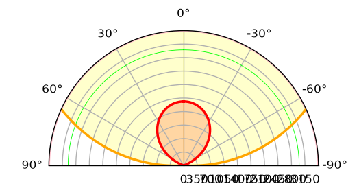

## Problem: Perception System is Hard to Visualize
As I made the perception system, I realized that it was difficult to connect the thresholds and weights in the code to the actual shapes of the zones. A designer could modify a threshold without really knowing how it would affect the shape of each zone.

## Solution: Build a Tool
I took an afternoon to build a Python script to visualize the shapes of the areas.

Rather than walk through all of the minutia of Matplotlib, I'll show the most important sections. This is what the tool looks like:

### Converting my code to a mathematical equation
The process I was using in engine was to calculate the detectability of a single point. This worked well for single targets, but mapping out the entire range would require transforming the vector dot product and other calculations into a set of equations that could be graphed. I decided that polar coordinates would be a good starting place.

I started out by asking an LLM to convert my code into an equation I could graph. It gave me an answer, but I wasn't sure if it was correct. I thoroughly verified its output by hand on paper, ensuring that I understood each step of the process.

This is where the equation started. It contains three terms: distance, angle, and light; and compares them to the threshold for the yellow zone.


$$
\frac{d*W_{distance}}{r_{total}} + cos(\theta)*W_{angle} + L*W_{light} = T_{yellow}
$$

Solving for d (which is the radius of the polar graph), this is the final equation used in matplotlib:

$$
d = r_{total}(\frac{-T_{yellow}+cos(\theta)*W_{angle}+L*W_{light}}{W_{distance}}+1)
$$

Plugging in each of these constants, I created a polar graph in terms of d and &theta;, which you have already seen.

## Outcome: Fixing a Design Problem
This tool is actually what led to splitting up the Red and Yellow zones: they were tightly coupled by using the exact same weights, which made it impossible to get both the Red and Yellow shapes I wanted. Working on this tool, I was able to see the problem visually and develop a solution.